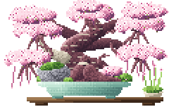
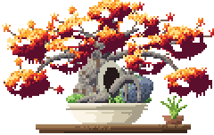
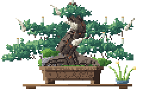
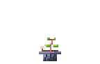
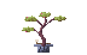
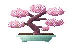
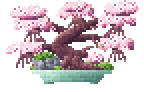

<h1 align="center">Pixel Bonsai</h1>

<p align="center">
  
  
  
</p>

<p align="center"><b>A tiny tree for your terminal that grows on the tokens your coding agents spend.</b></p>

Every model call your agents make feeds the tree. Pick a sakura, a Japanese maple, or a Japanese black pine and watch
it climb twenty stages, from a seed in a bare pot to a venerable old tree on its display stand.

<p align="center">
  
  
  
  
  
  <br>
  <sub>seedling → first branches → shaped → established → venerable</sub>
</p>

Each variety grows two trees. Today's tree starts fresh at midnight: a light day grows a sapling, and a marathon of
refactoring can carry it all the way to venerable. The lifetime tree keeps every token and takes its time, since it
needs hundreds of billions to grow old.

## Install

Grab the archive for your system from the [releases page](https://github.com/KrishRVH/pixel-bonsai/releases), unpack
it, and put `pixel-bonsai` on your `PATH`. It's a single binary for Windows, macOS, or Linux, with nothing else to
install. With Go 1.27 or later, you can build it instead:

```sh
go install github.com/KrishRVH/pixel-bonsai@latest
```

## Grow a tree

```sh
pixel-bonsai
```

The tree fills the terminal, as big as fits, above a caption with its name, stage, and tokens. Windows Terminal and any
modern macOS or Linux terminal will show it.

| Press or click | To |
| --- | --- |
| **V**, **Tab**, **→**, or the tree's name | Switch to the next tree |
| **←** | Switch back |
| **Space**, any other key, or anywhere else | Flip between today and lifetime |
| **Q**, **Ctrl+C**, or **Ctrl+D** | Leave it to grow |

New tokens go to whichever tree is showing, so switch whenever you like. The bonsai checks for new usage every minute
and saves the garden as it goes, so your trees keep growing between sessions, and several terminals can share one
garden.

## Feed it

The bonsai finds the usage logs these agents already keep, with no setup:

**Claude Code** · **Codex** · **GitHub Copilot CLI** · **Antigravity** · **Pi** · **Oh My Pi** ·
**OpenCode** · **Kilo Code** · **Qwen Code** · **Kimi Code** · **Goose**

Cursor joins with [a small hook](docs/harnesses.md#cursor). Any other agent can report its own calls:

```sh
pixel-bonsai record --source my-agent --id session42/turn7 --tokens 1250
```

To see which agents the bonsai found and how much each has fed it, run `pixel-bonsai doctor`.
[Harnesses](docs/harnesses.md) shows where each agent keeps its usage.

## Draw a tree anywhere

Want a tree in your status bar, a dashboard, or a game? Ask for one frame at any age, from 0 (a seed) to
1 (venerable):

```sh
pixel-bonsai render --variety maple --growth 0.7 --format png --zoom 8 > maple.png
```

It also draws in terminal colors or as JSON pixels, and Go programs can import the drawing kit, `art`, and the trees,
`bonsai`, directly. The [integration contracts](docs/integrations.md) have the details.

## Make it your own

New trees, new harnesses, and art tweaks are welcome. [AGENTS.md](AGENTS.md) explains how the project fits together
and how to change it.

## License

[MIT](LICENSE).
